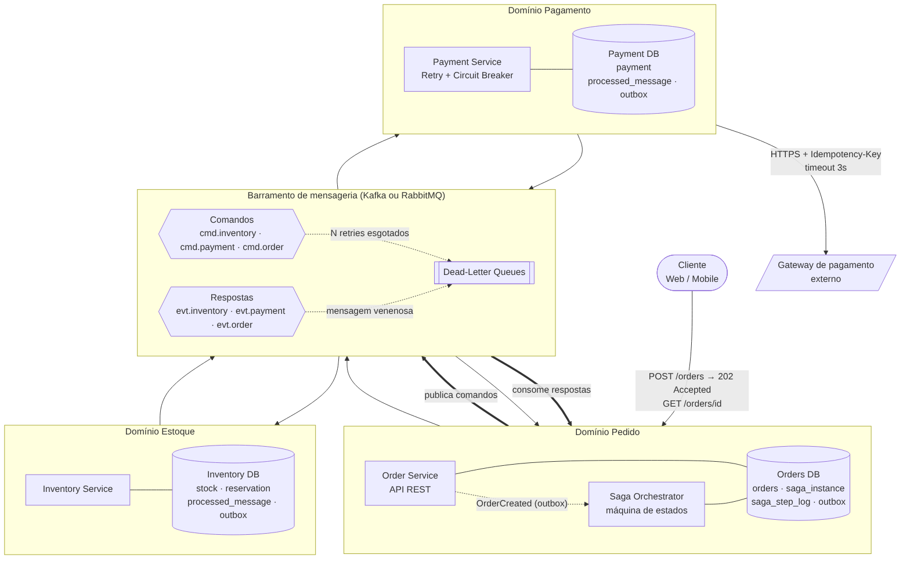
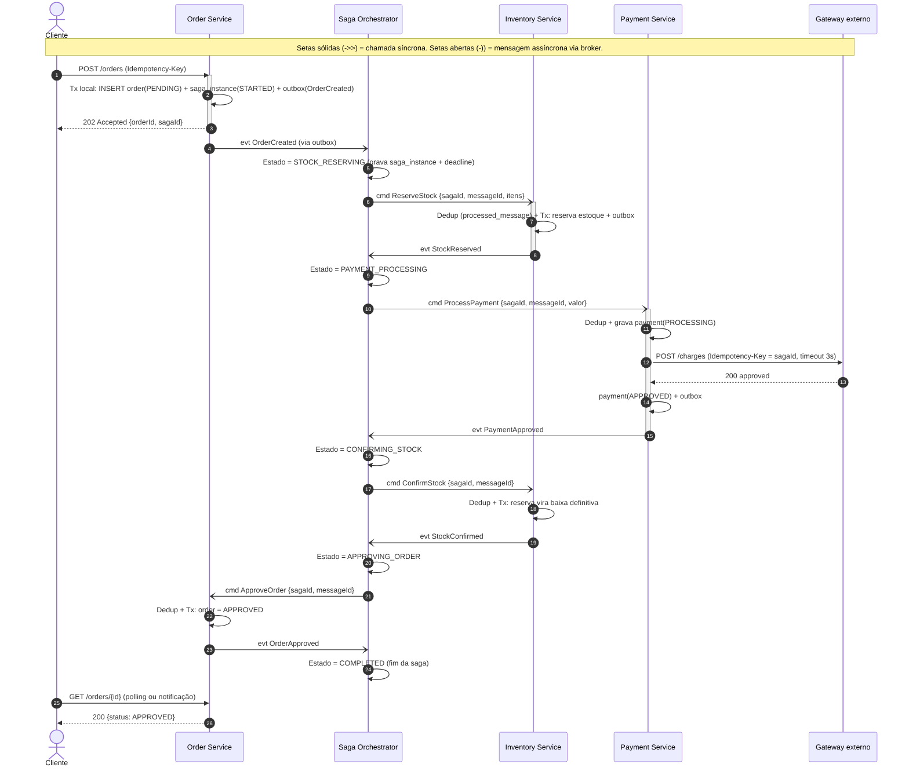
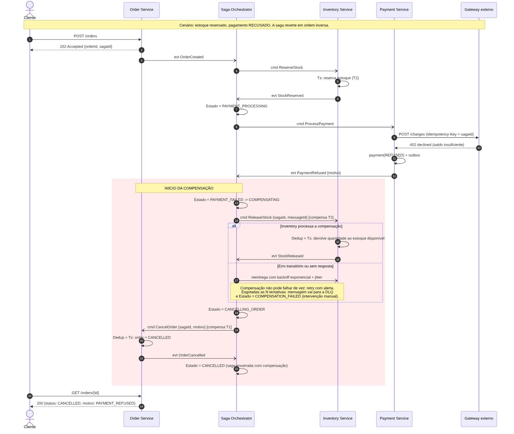
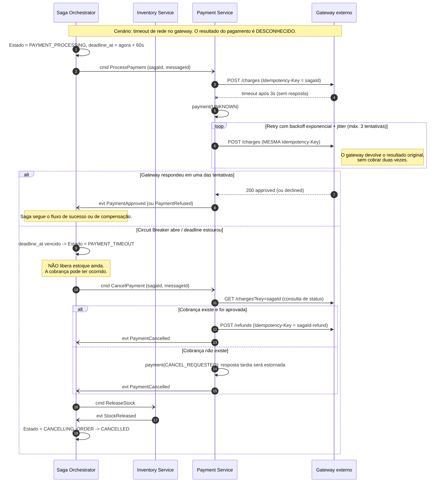
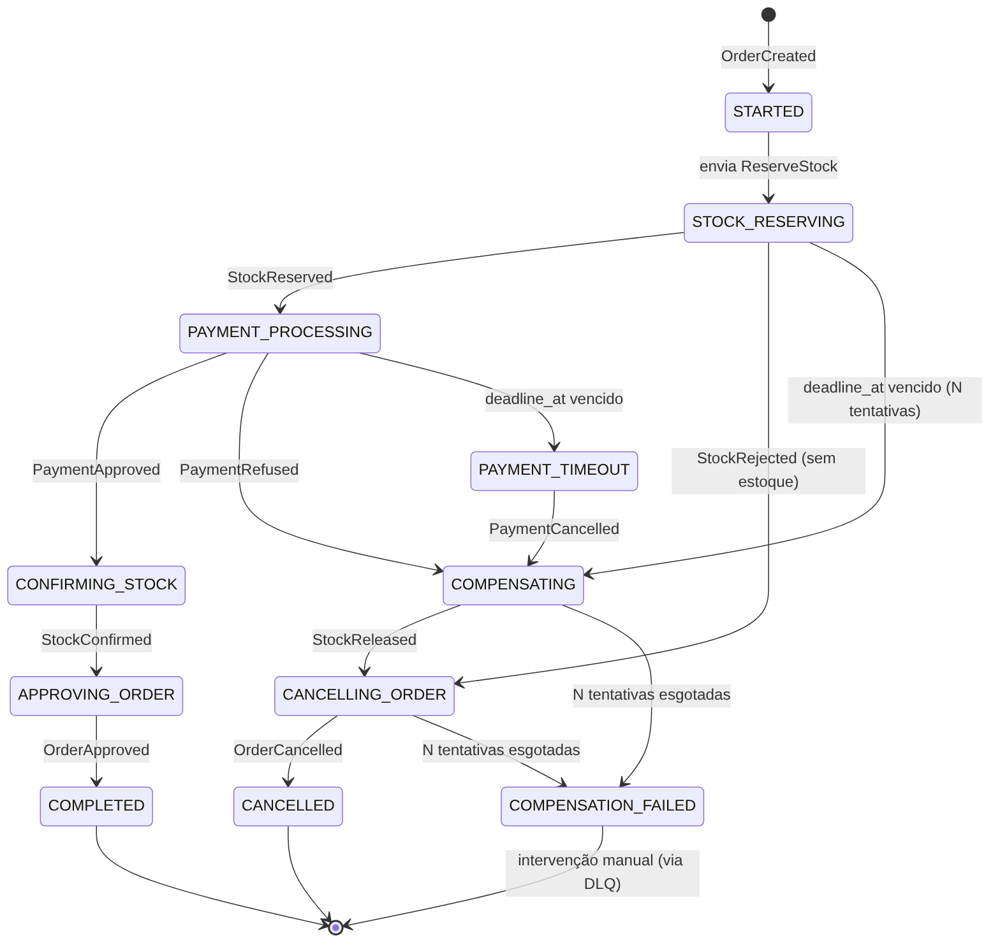

# Saga Pattern: Blueprint de Arquitetura para o Fluxo de Compra

> Blueprint de uma Saga orquestrada para a migração de um monólito de e-commerce para microsserviços.
> O escopo é arquitetura e modelagem; não há código de aplicação.
> Referência do padrão: [microservices.io/patterns/data/saga](https://microservices.io/patterns/data/saga.html)

---

## 1. Contexto de negócio

Uma empresa de e-commerce de grande porte está tirando o fluxo de compra de dentro do monólito e distribuindo entre microsserviços. No monólito, criar o pedido, baixar o estoque e cobrar o cliente aconteciam dentro de uma única transação ACID: tudo-ou-nada, no mesmo banco. Ou os três davam certo juntos, ou nada era gravado.

Na arquitetura nova cada domínio ganhou serviço e banco próprios:

| Serviço | Responsabilidade | Banco |
|---|---|---|
| Order Service | Registrar e gerenciar o ciclo de vida do pedido | Orders DB |
| Inventory Service | Gerenciar estoque e fazer reservas temporárias | Inventory DB |
| Payment Service | Processar pagamento com gateways financeiros externos | Payment DB |

Com isso, deixou de existir uma transação que cubra os três bancos. Dá para argumentar por 2PC/XA, mas na prática não fecha: bloqueia recursos, não escala, e o gateway externo nem sequer participa de transações distribuídas. O que sobra é consistência eventual com reversão explícita. Se uma etapa lá na frente falha, as anteriores precisam ser desfeitas por uma operação de compensação. É exatamente esse o problema que a Saga resolve.

O risco de negócio que estou endereçando é concreto. Imagine o cliente com o produto reservado, o pagamento recusado, e o estoque ficando preso para sempre porque ninguém mandou devolver. Pior ainda: o cartão cobrado e o pedido cancelado. Os dois cenários custam dinheiro, um como venda perdida, o outro como estorno mais atendimento. A Saga existe para garantir que o sistema sempre chegue a um estado final coerente: pedido aprovado, ou pedido cancelado com tudo revertido. Não há meio-termo que fique de pé.

---

## 2. Decisão: Saga orquestrada

Optei por orquestração. Um Saga Orchestrator central guarda o estado da transação e comanda os participantes, que só sabem receber comandos e devolver respostas.

A alternativa seria coreografia, com os serviços reagindo a eventos uns dos outros sem um maestro. Comparei as duas pelos atributos de qualidade que importam aqui:

| Atributo | Orquestração | Coreografia |
|---|---|---|
| Acoplamento | Participante conhece só os comandos que recebe e as respostas que devolve; o fluxo inteiro mora no orquestrador. | Cada serviço precisa saber quais eventos de quais outros serviços escutar. O fluxo fica espalhado e implícito. |
| Complexidade do fluxo | Quatro passos e duas compensações cabem numa máquina de estados, num lugar só. | Tranquilo com dois ou três serviços. A cada passo novo (antifraude, fidelidade, nota fiscal) crescem as assinaturas de eventos entre serviços. |
| Visibilidade e depuração | "Onde está o pedido X?" é uma consulta SQL na tabela de estado. | Para achar onde travou é preciso correlacionar eventos de vários serviços. |
| Dependência cíclica | Baixa; as dependências apontam para o orquestrador. | Alta; serviços escutam uns aos outros e ciclos surgem fácil. |
| Timeout e compensação | Centralizados: o orquestrador tem o prazo (`deadline_at`) e decide quando compensar. | Cada serviço precisa do próprio relógio e de coordenação. |
| Escalabilidade | O orquestrador só coordena, não roda regra de negócio; escala na horizontal, com concorrência controlada por optimistic locking. | Não tem ponto central, mas paga o preço em complexidade operacional. |
| Ponto único de falha | Risco real, e mitigável: orquestrador stateless com estado persistido, várias instâncias, partição por `sagaId`. | Não existe. |

Coreografia seria uma escolha defensável num fluxo de dois passos. Não é o caso. Aqui há três domínios, uma etapa de resultado incerto (o gateway externo), compensações que importam na ordem e uma exigência de auditoria financeira. Nesse contexto, pesa mais ter o fluxo explícito, auditável e testável do que economizar o componente central. O orquestrador ser ponto único de falha é um risco que se trata com técnicas conhecidas, descritas em [docs/decisoes-arquiteturais.md](docs/decisoes-arquiteturais.md).

---

## 3. Visão geral da arquitetura



Alguns princípios guiam o desenho:

- Cada serviço tem banco isolado. Nenhum serviço lê o banco do outro.
- A comunicação do fluxo é toda assíncrona, via broker (Kafka ou RabbitMQ), com tópicos de comando (orquestrador para serviço) e de resposta (serviço para orquestrador).
- As únicas chamadas síncronas são a do cliente ao Order Service (`POST /orders`, que responde `202 Accepted`) e a do Payment Service ao gateway externo, esta protegida por timeout, retry e circuit breaker.
- Todo serviço usa Transactional Outbox: a mudança de estado e a mensagem a publicar são gravadas na mesma transação local. Assim some o clássico "gravou no banco mas não publicou".
- Mensagem que falha depois de N tentativas vai para uma Dead-Letter Queue.

---

## 4. Fluxo de sucesso



1. O cliente faz `POST /orders` com um `Idempotency-Key`. Na mesma transação, o Order Service grava `order(PENDING)`, `saga_instance(STARTED)` e a mensagem de outbox, e responde `202 Accepted`.
2. O orquestrador recebe `OrderCreated` e dispara `ReserveStock`. O Inventory faz uma reserva temporária da quantidade e responde `StockReserved`.
3. O orquestrador envia `ProcessPayment`. O Payment chama o gateway com uma chave de idempotência (o próprio `sagaId`) e responde `PaymentApproved`.
4. Vem `ConfirmStock`, que transforma a reserva em baixa definitiva, e em seguida `ApproveOrder`.
5. A saga chega a `COMPLETED`. O cliente acompanha o status por polling ou notificação.

---

## 5. Fluxo de falha e compensação



O cenário pedido no enunciado: o Payment Service recusa o pagamento depois que o Inventory já reservou o produto.

1. O gateway responde `402 declined` e o Payment emite `PaymentRefused`.
2. O orquestrador entra em `COMPENSATING` e desfaz, em ordem inversa, as transações que já tinham sido confirmadas. Primeiro `ReleaseStock`, que devolve ao disponível a quantidade reservada. Depois `CancelOrder`, que marca o pedido como `CANCELLED` com o motivo.
3. A saga termina em `CANCELLED`. O pedido nunca fica preso num estado intermediário.

O par transação/compensação fica assim:

| Transação (T) | Compensação (C) |
|---|---|
| T1 · `CreateOrder` (PENDING) | C1 · `CancelOrder` |
| T2 · `ReserveStock` | C2 · `ReleaseStock` |
| T3 · `ProcessPayment` | C3 · `CancelPayment` / refund (usada no timeout) |

E se a própria compensação falhar? Ela é reexecutada com backoff. Esgotadas as tentativas, a saga vai para `COMPENSATION_FAILED`, a mensagem cai na DLQ e dispara um alerta para intervenção manual. Compensação que falha de vez é incidente, não estado final de rotina.

### O caso que mais dói: timeout no gateway



Pagamento recusado é ruim, mas tratável. O que realmente assusta é o pagamento desconhecido: o gateway não respondeu e eu não sei se ele cobrou ou não. A regra, aqui, é inflexível. Nunca liberar o estoque antes de ter certeza do resultado do pagamento. O passo a passo está na seção de idempotência e timeouts do documento técnico.

### Máquina de estados da saga



---

## 6. Resiliência e idempotência

A íntegra está em [`docs/decisoes-arquiteturais.md`](docs/decisoes-arquiteturais.md). Como mapa rápido das ameaças e das respostas:

| Ameaça | Mecanismo |
|---|---|
| Mensagem duplicada / reentrega do broker | Idempotent Consumer: tabela `processed_message` com chave `(message_id, consumer)`, gravada na mesma transação da mudança de negócio |
| Cobrança em duplicidade no gateway | `Idempotency-Key = sagaId` em toda chamada ao gateway |
| Timeout de rede | `deadline_at` na `saga_instance`, job de varredura e consulta de status antes de compensar |
| Falha entre gravar e publicar | Transactional Outbox |
| Orquestrador cai no meio da saga | Estado persistido; outra instância retoma a partir de `saga_instance` |
| Execução concorrente da mesma saga | Optimistic locking (coluna `version`) |
| Mensagem que nunca é processada | DLQ, alerta e reprocessamento controlado |
| Gateway instável | Retry com backoff exponencial e jitter, mais circuit breaker |

---

## 7. Estrutura do repositório

```text
.
├── README.md                          # este documento
├── diagrams/
│   ├── saga-architecture-overview.png # os serviços e o barramento
│   ├── sequence-success-flow.png      # o fluxo feliz
│   ├── sequence-compensation-flow.png # a reversão (pagamento recusado)
│   ├── sequence-timeout-flow.png      # extra: timeout / resultado desconhecido
│   ├── saga-state-machine.png         # extra: estados e transições
│   └── *.mmd                          # as fontes editáveis (Mermaid)
└── docs/
    └── decisoes-arquiteturais.md      # ADRs, riscos, DLQ, retry, circuit breaker
```

Os diagramas são [Mermaid](https://mermaid.js.org/). Para editar, cole o conteúdo de um `.mmd` em [mermaid.live](https://mermaid.live), ou num bloco ` ```mermaid ` de qualquer Markdown, que o GitHub renderiza sozinho. Para gerar o PNG:

```bash
npm install -g @mermaid-js/mermaid-cli
mmdc -i diagrams/sequence-success-flow.mmd -o diagrams/sequence-success-flow.png -s 2 -b white
```

---

## 8. Limites deste blueprint

Vale ser honesto sobre o que uma Saga não entrega. Ela não tem o "I" do ACID. Entre T1 e o fim da saga, outras leituras podem enxergar estados intermediários, como um pedido `PENDING` ou um estoque já reservado. Isso se mitiga com semantic lock (esses estados são explícitos e tratados pelas demais regras), e está detalhado no documento técnico.

Dois pontos finais. Este repositório descreve a arquitetura; as escolhas de tecnologia (Kafka ou RabbitMQ, Postgres ou outro banco) são recomendações, não parte do contrato. E os valores de timeout, número de retries e limiares do circuit breaker são pontos de partida, para calibrar com dados reais de produção.
